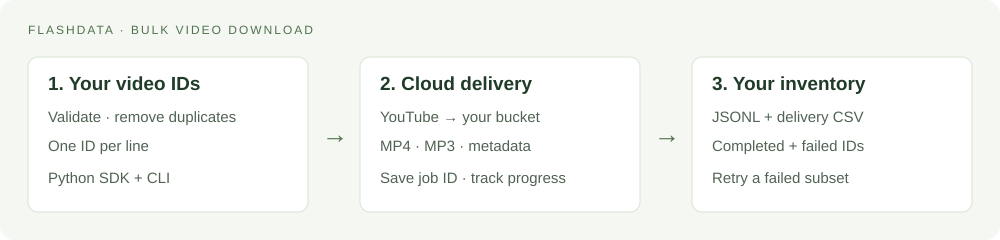

# Bulk Video Download with Python

[](https://github.com/flashdatadev/bulk-video-download/actions/workflows/ci.yml)
[](https://www.python.org/)
[](LICENSE)

**Bulk download YouTube videos from a text file to your cloud storage. Save the job, follow its progress, and export a delivery inventory with failed IDs for selective retries.**

A Python toolkit for batch MP4 downloads, MP3 audio collections and video datasets, built on the [official FlashData SDK](https://github.com/flashdatadev/flashdata-python). FlashData handles YouTube extraction, bot challenges, proxy routing, retries and media delivery. Your machine prepares the collection and tracks the results.



[Quickstart](#quickstart-bulk-download-youtube-videos) · [Offline demo](#try-the-workflow-without-an-api-key) · [CLI](#command-line-workflow) · [Recovery](docs/recovery.md) · [Video datasets](docs/video-datasets.md) · [Storage setup](docs/storage.md)

## What this bulk downloader does

| Your task | What you get |
| --- | --- |
| Download multiple videos from a text file | One bulk job with shared format, quality and storage settings |
| Clean a large collection | ID validation, deduplication and a normalized input file; SQLite keeps the ID index off the Python heap |
| Continue after a terminal disconnect | An accepted job ID saved before upload; collect the same job after restarting |
| Find completed media | JSONL results, a CSV of delivered files, completed IDs and a summary |
| Retry only failed downloads | A separate `failed-ids.txt`, published only after every input has a result |
| Build a video dataset | Best-quality MP4 plus companion metadata, with IDs preserved for transcript joins |

This repository supports **YouTube**. Media goes to your configured cloud bucket; the local results directory contains inventories. The toolkit is MIT-licensed. Live API jobs use a FlashData account and credits. See [API pricing and the free trial](https://flashdata.dev/products/youtube-download?utm_source=github&utm_medium=readme&utm_campaign=bulk-video-download).

## Quickstart: bulk download YouTube videos

Requires **Python 3.10+**, a [FlashData API key](https://flashdata.dev/signup?utm_source=github&utm_medium=readme&utm_campaign=bulk-video-download), and a cloud bucket that FlashData can write to. No local yt-dlp, FFmpeg or Deno installation is needed for this API workflow.

### 1. Install

```bash
git clone https://github.com/flashdatadev/bulk-video-download.git
cd bulk-video-download
python -m pip install -e .
```

A virtual environment is recommended: `python -m venv .venv`, then `source .venv/bin/activate` on Linux/macOS or `.\.venv\Scripts\Activate.ps1` on Windows before installing.

### 2. Prepare a video ID file

Create `video-ids.txt`, one **11-character video ID** per line:

```text
jNQXAC9IVRw
dQw4w9WgXcQ
9bZkp7q19f0
```

Use IDs, not full URLs, `youtu.be` links, channel URLs, playlists, CSV headers or JSON. For `https://www.youtube.com/watch?v=jNQXAC9IVRw`, the ID is `jNQXAC9IVRw`. Blank lines and duplicates are removed automatically; an invalid line stops submission and reports its line number.

### 3. Run your collection in Python

Save this as `download.py` (gitignored), replace the placeholders, and run `python download.py`:

```python
from pathlib import Path
from flashdata import FlashData
from bulk_video_download import start, collect, progress_line

storage = {
    "storage_type": "s3",
    "storage_url": "your-media-bucket",
    "region": "us-east-1",
    "access_key": "your-storage-access-key",
    "secret_key": "your-storage-secret-key",
    "object_prefix": "collections/run-01",
}
run = Path("runs/collection-01")

with FlashData(api_key="your-flashdata-api-key") as client:
    if not run.exists():
        start(client, "video-ids.txt", run_dir=run, storage=storage, preset="mp4")
    summary = collect(
        client,
        run,
        on_progress=lambda job, total: print(progress_line(job, total), flush=True),
    )
print(summary)
```

**Run the same script again to collect the existing job.** It does not submit that run twice. Use a new run directory for a new collection. If the upload/start step was interrupted or the job is paused, use the [recovery steps](docs/recovery.md).

MP4 uses video plus audio with a 1080p ceiling. Change `preset="mp4"` to `"mp3"` for audio, or `"dataset"` for best-quality video plus companion metadata. [Runnable Python example](examples/download_collection.py) · [Cloudflare R2 and other storage](docs/storage.md)

## Try the workflow without an API key

```bash
python -m bulk_video_download demo
```

This **offline demo uses synthetic responses**, including one failed item. It exercises the real SDK, checkpoint and export code without contacting an API or downloading media. Example output:

```text
OFFLINE DEMO: synthetic responses; no media download or API requests.
bulk_offline_demo | completed | 3/3 finished | 2 delivered | 1 failed
```

Inspect `runs/demo/results/`, then run the command again to read the saved result. To see a real single-video download before configuring storage, use the [live browser playground](https://flashdata.dev/products/youtube-download#playground). API bulk jobs deliver to your bucket.

## Output you can use in a pipeline

```text
runs/collection-01/
├── run.json                  # Accepted job ID, input hash and phase; no credentials
├── video-ids.txt              # Exact normalized IDs submitted
└── results/
    ├── summary.json          # Completed, failed, needs-review and delivered bytes
    ├── manifest.json         # Bulk result manifest
    ├── results.jsonl         # Full per-video results, including errors
    ├── deliveries.csv        # video_id, job_id, file_url, file_size
    ├── completed-ids.txt     # IDs with completed media delivery
    ├── failures.jsonl        # Failure details for inspection
    └── failed-ids.txt        # Confirmed failed downloads for an intentional retry
```

An interrupted or incomplete export never becomes a finished `results/` directory. Collection verifies that every submitted ID has exactly one matching result before publishing the inventory. Result-record failures that do not establish whether media was delivered are counted as `needs_review`, excluded from the retry file, and retained in `failures.jsonl`.

See [result fields and retry behavior](docs/results.md). Private bucket objects remain private; use your storage account to read them.

## Command-line workflow

For CLI use, copy **[config.example.py](config.example.py)** to `config.py` and set `API_KEY` and `STORAGE` there. This is a settings-only configuration, separate from the quickstart script above.

```bash
# Validate and deduplicate locally; no credentials needed
flashdata-bulk prepare video-ids.txt output/ready-ids.txt

# Submit MP4 collection, print progress, and export results
flashdata-bulk run output/ready-ids.txt --run runs/mp4-01

# Inspect or collect the same job after disconnecting
flashdata-bulk status --run runs/mp4-01
flashdata-bulk collect --run runs/mp4-01

# Explicitly resume a paused job or start an already-uploaded draft
flashdata-bulk resume --run runs/mp4-01

# A new job containing only confirmed failures
flashdata-bulk run runs/mp4-01/results/failed-ids.txt --run runs/retry-01
```

An empty retry file is rejected locally. Review the errors before retrying: a removed source or incorrect storage configuration needs attention first. Use `--config private-settings.py` for another settings file and `--help` for all commands. `python -m bulk_video_download` is equivalent to `flashdata-bulk`.

Exit codes: **0** complete; **2** results exported with failed or needs-review items; **1** an error prevented completion; **130** local waiting interrupted. The deliberately mixed offline demo returns 0 when it runs successfully.

## Batch MP3 audio downloads

```bash
flashdata-bulk run video-ids.txt --preset mp3 --run runs/audio-01
```

The audio preset requests MP3 at 192 kbps. To choose another supported format, use Python options:

```python
start(
    client,
    "video-ids.txt",
    run_dir="runs/m4a-01",
    storage=storage,
    preset="mp3",
    output_format="m4a",
    audio_quality="best",
)
```

## Bulk video downloads for datasets

```bash
flashdata-bulk run video-ids.txt --preset dataset --run runs/dataset-01
```

This preset requests best video plus audio, MP4 output and companion metadata. Use `completed-ids.txt` to join media with transcript or caption results by `video_id`. Transcripts are a separate data request, not embedded by this preset. See the [video dataset recipe](docs/video-datasets.md) for quality choices, stable storage prefixes and collection handoff.

## Local downloader or managed bulk API?

| Need | Practical starting point |
| --- | --- |
| Save files directly to your laptop and control yt-dlp options | [yt-dlp](https://github.com/yt-dlp/yt-dlp) or a local batch wrapper |
| Use a desktop download queue | A desktop downloader with a queue and local output |
| Run Python collection jobs with cloud delivery and per-video inventory | This repository |
| Learn single-video requests, clips, formats and local S3 retrieval | [YouTube Video Download API Toolkit](https://github.com/flashdatadev/youtube-video-download-api) |
| Have a team source and deliver an agreed dataset | [Managed video datasets](https://flashdata.dev/products/youtube-video-datasets?utm_source=github&utm_medium=readme&utm_campaign=bulk-video-download) |

The project was informed by the straightforward file-to-download workflow in [EDM115/bulk-youtube-download](https://github.com/EDM115/bulk-youtube-download) and the queue/progress emphasis in [HaseebKaloya/Bulk-Video-Downloader](https://github.com/HaseebKaloya/Bulk-Video-Downloader). This implementation uses FlashData cloud jobs and contains original Python code.

## Frequently asked questions

**Can I download a whole playlist or channel?**

First resolve it to video IDs using your collection/search workflow, then submit the ID file. This tool does not expand playlist or channel URLs. [YouTube Data API examples](https://github.com/flashdatadev/youtube-data-api) cover video discovery and metadata.

**How many videos can I submit?**

The Bulk API accepts an ID file up to 2 GiB. This tool streams input and uses disk-backed indexes. API admission, account credits and storage must be available for the job to progress. Local Python thread counts do not control FlashData's download workers.

**Does stopping Python stop the downloads?**

Remote work continues. Keep the run directory and use `collect` to read the same accepted job. A paused remote job requires explicit `resume` after its pause reason is resolved.

**Do I need browser cookies or a local proxy pool?**

The FlashData workflow accepts IDs, media options and storage settings. FlashData operates the retrieval infrastructure.

**Where are the MP4 files?**

In your configured bucket. `deliveries.csv` identifies the delivered objects; the local folder is an inventory, not a copy of the media.

**Can I run it on a server?**

Yes. Python 3.10+ on Linux, macOS or Windows; no desktop session is required. CI runs offline workflow checks across all three operating systems.

## Development

```bash
python -m pip install -e ".[dev]"
python -m pytest
python -m ruff check .
python -m ruff format --check .
python -m build
```

Tests use the actual SDK with an in-memory HTTP transport. They cover lost submission/start responses, interrupted exports, input validation, duplicate results and recovery without resubmission.

[Contributing](CONTRIBUTING.md) · [Security](SECURITY.md) · [MIT license](LICENSE) · [Bulk API reference](https://flashdata.dev/docs/reference/bulk-processing) · [YouTube download parameters](https://flashdata.dev/docs/sources/youtube_download) · [Support](mailto:support@flashdata.dev)
